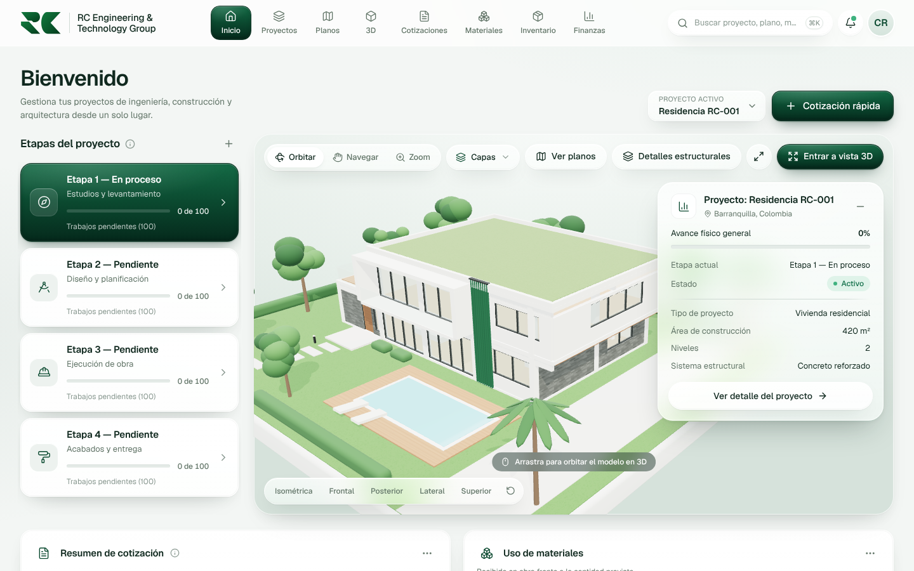

# RC Engineering OS · Home v0.1

Primera versión del **Engineering Operating System** de RC Engineering & Technology Group:
un centro de control donde la maqueta 3D de la obra, las etapas constructivas, las actividades,
las cotizaciones, los materiales, el inventario y las finanzas comparten los mismos datos.



## Ejecutar

```bash
git clone https://github.com/MigueArce1999/RCEngineering.git
cd RCEngineering
npm install
npm run dev            # http://localhost:3000
```

| Script | Qué hace |
|---|---|
| `npm run dev` | Servidor de desarrollo |
| `npm run build` / `npm start` | Build de producción y servidor |
| `npm run lint` | ESLint (config de Next 16) |
| `npm run typecheck` | `tsc --noEmit` |
| `npm run check` | lint + typecheck + build |
| `node scripts/generate-blueprints.mjs` | Regenera los planos SVG ilustrativos |

## Publicar (GitHub Pages)

El workflow `.github/workflows/deploy-pages.yml` publica el sitio en cada push a `main`
(lint + typecheck + build estático con `NEXT_PUBLIC_BASE_PATH=/RCEngineering`).

1. Una sola vez: **Settings → Pages → Build and deployment → Source: GitHub Actions**.
2. Ejecutar el workflow desde **Actions → Publicar en GitHub Pages → Run workflow** (o hacer push a `main`).
3. Sitio: https://miguearce1999.github.io/RCEngineering/

Build estático local: `NEXT_PUBLIC_BASE_PATH=/RCEngineering npm run build` → carpeta `out/`.

## Base de datos (Supabase)

Proyecto Supabase `ypbvpctzunsaxylmqjtc`. La URL y la clave **publicable** están en `.env`
(son públicas; la seguridad la dan las políticas RLS). Sin esas variables la app funciona en
modo local con los datos de demostración.

- Esquema: `supabase/migrations/` (tablas, RLS y privilegios). Datos demo: `supabase/seed.sql`
  (se regenera con `npx tsx scripts/build-seed.ts`).
- **Acceso**: la app abre en la pantalla de inicio de sesión / creación de cuenta. Sin sesión no se
  ven datos (lo exige la base de datos con RLS).

### Proyectos reales y asistente “Completa tu proyecto”
La migración `20261119010000_rc_onboarding.sql` borró los datos de demostración de Supabase
(`supabase/seed.sql` queda solo como referencia). Cada proyecto se carga paso a paso desde la app;
ver el análisis en [docs/ONBOARDING-UX.md](docs/ONBOARDING-UX.md).

### Modelo 3D propio de cada proyecto
Desde el visor (**Cargar modelo**, roles con *Gestionar proyectos*) se sube el modelo como archivo
`.html` autocontenido (por ejemplo el visor three.js del proyecto). Se guarda en el bucket privado
`project-models` y se muestra en un `iframe` aislado (`sandbox` sin `allow-same-origin`): no puede leer
la sesión ni los datos de la app. Lo que el modelo guarda en `localStorage` (p. ej. alturas) se
persiste en `projects.model_settings` para todo el equipo.

El visor solo captura la rueda y los gestos **después de un clic** sobre el modelo (o en la vista 3D
ampliada); antes, la rueda desplaza la página.

### Nómina de obra
Módulo **Nómina** (barra superior; visible para Administrador, Director y Presupuestos, permiso
`payroll.manage`). Trabajadores con cargo y valor día; liquidaciones quincenales (1–15 / 16–fin) o
mensuales con días trabajados, valor día, extras y descuentos por persona. Total = días × valor día
+ extras − descuentos. Al **marcar como pagada** se registra el gasto de mano de obra en Finanzas
(se elimina si se reabre). Exporta a CSV para Excel. No calcula seguridad social ni prestaciones.

### Roles

| Rol | Ver | Actividades | Etapas | Cotizaciones | Usuarios |
|---|:-:|:-:|:-:|:-:|:-:|
| Administrador | ✓ | ✓ | ✓ | ✓ | ✓ |
| Director de proyecto | ✓ | ✓ | ✓ | ✓ | |
| Ingeniero / Residente | ✓ | ✓ | | | |
| Presupuestos | ✓ | | | ✓ | |
| Consulta (rol inicial) | ✓ | | | | |

Roles y permisos viven en las tablas `roles`, `permissions` y `role_permissions`. Un administrador
asigna roles desde **avatar → Usuarios y roles** (función `set_user_role`; nadie cambia su propio rol).
El primer administrador se define en `public.admin_bootstrap` (correo que recibe el rol al registrarse,
uso único) desde el SQL Editor; esa tabla no es accesible desde la app.

### Configuración necesaria en Supabase (enlaces de correo)
**Authentication → URL Configuration**:
- *Site URL*: `https://miguearce1999.github.io/RCEngineering/`
- *Redirect URLs*: agregar `https://miguearce1999.github.io/RCEngineering/` y `http://localhost:3000/`

## Stack

Next.js 16 (App Router) · React 19 · TypeScript estricto · Tailwind CSS 4 con tokens en CSS
variables · Framer Motion · Radix UI (Dialog, Popover, Dropdown, Tooltip) · cmdk · Lucide ·
Recharts · Zustand (persistencia local) · Three.js + React Three Fiber + Drei · Geist.

## Qué funciona

- **Navbar** horizontal con estado activo animado (cristal verde), tooltips, menú compacto en
  tablet/móvil. Cada módulo abre algo real: Proyectos, Cotizaciones, Materiales, Inventario y
  Finanzas abren su panel; Planos abre el visor; 3D abre la vista inmersiva.
- **Búsqueda global / Command Palette** (`⌘K` / `Ctrl+K`) sobre proyectos, 400 actividades,
  planos, materiales, cotizaciones y elementos del modelo 3D.
- **Etapas**: 4 etapas × 100 actividades. El avance de cada etapa = completadas / total; el avance
  general pondera las etapas por su peso (8 / 12 / 62 / 18 %). Drawer con búsqueda, filtro por
  estado, completar/reabrir, cambio de estado, responsable, fecha, prioridad, observaciones,
  nueva actividad, renombrar y reordenar etapas, y agregar etapas.
- **Visor 3D** (carga diferida, render bajo demanda): orbitar / desplazar / zoom, vistas
  isométrica, frontal, posterior, lateral y superior con transiciones, restablecer, pantalla
  completa y modo inmersivo que conserva la cámara. Modos: arquitectónico, estructural
  (cimentación visible), cubierta, por niveles, avance constructivo (colores derivados de las
  actividades vinculadas) y explotado. Eléctrico e hidrosanitario aparecen como **no
  disponibles** (requieren BIM/IFC). Selección de muros, columnas, vigas, losas, cubiertas,
  puertas y ventanas con inspector: material, dimensiones, estado, etapa, actividades, planos y
  costo paramétrico. Fallback si no hay WebGL.
- **Visor de planos**: 12 planos SVG por categoría y nivel, zoom con rueda/botones/teclado,
  arrastre, pantalla completa, soporte PDF por `<object>`. Marcados como ilustrativos.
- **Cotización rápida**: cliente, proyecto, descripción, ítems múltiples (categoría, unidad,
  cantidad, precio), descuento, AIU opcional, IVA opcional (sobre la utilidad cuando hay AIU),
  validación, vista previa y guardado como borrador (en Supabase; en modo local, en el navegador).
- **Dashboard inferior**: cotizaciones (total, aprobadas/pendientes, distribución por categoría),
  materiales (recibido vs. previsto con unidades reales), inventario (referencias, stock bajo,
  movimientos por semana — se cuentan movimientos, nunca se suman unidades distintas), finanzas en
  COP (`Intl.NumberFormat("es-CO")`, ejecución = ejecutado / presupuesto, desviación vs. curva
  planeada, separado del avance físico) y actividad pendiente sincronizada con las etapas.
- Toasts, skeleton de carga del visor, `prefers-reduced-motion`, foco visible, etiquetas ARIA.

## Arquitectura

```
src/
  app/                 layout, page, globals.css (tokens + materiales glass en @layer components)
  types/               Modelo de dominio (Project, Task, Quote, ModelElement…)
  data/                demo.ts y tasks.ts — DATOS FICTICIOS centralizados
  lib/
    domain.ts          Lógica pura: avance, estado de elementos, totales de cotización, inventario, finanzas
    format.ts          Formatos es-CO (COP, fechas, porcentajes)
    house/spec.ts      Geometría paramétrica de la vivienda = fuente única para render, inspector y vínculos
  stores/              projectStore (dominio, persistido) · uiStore (UI y visor)
  hooks/               useProjectData (selectores derivados)
  components/
    layout/            Navbar, DashboardHeader/ProjectSelector, SearchCommand
    dashboard/         EngineeringDashboard, StagePanel, StageDetailDrawer, ProjectInfoCard, widgets
    viewer/            ArchitecturalViewer, ViewerCanvas, HouseModel, Site, materials, ElementInspector, BlueprintViewer
    quotes/            QuickQuoteModal (+ QuoteItemRow, QuoteTotals)
    modules/           Paneles de módulo, detalle de material/proyecto, configuración
    ui/                primitives (GlassCard, GlassButton, ProgressBar, StatusBadge…), overlays (Modal, Drawer, Tooltip, Toaster)
public/branding · public/blueprints · public/models
```

Para conectar backend (Supabase/PostgreSQL): las acciones de `projectStore` (`setTaskStatus`,
`addTaskNote`, `saveQuote`, `moveStage`…) se mapean 1:1 a mutaciones; `data/` se reemplaza por
consultas con los mismos tipos de `types/`.

## Limitaciones y pendientes

- **Modelo 3D procedural**: construido con geometría paramétrica (no es un GLB fotorrealista). Ver
  [docs/3D-MODELO.md](docs/3D-MODELO.md) para sustituirlo por GLB/IFC conservando los vínculos.
- Instalaciones eléctricas/hidrosanitarias en 3D, DWG/DXF/IFC: pendientes (requieren BIM y librerías específicas).
- Los Términos de uso y la Política de privacidad son borradores pendientes de revisión legal.
- Materiales, inventario, gastos y planos se leen de Supabase pero aún no se editan desde la app.
- Solo RC-001 tiene datos; RC-002 y RC-003 aparecen como “sin datos”.
- Costos de elementos 3D son paramétricos de demostración, no APU aprobados.
- Sin pruebas unitarias todavía; la lógica en `lib/domain.ts` es pura y está lista para Vitest.
- Three.js es la dependencia más pesada; se carga de forma diferida y no bloquea el resto del Home.

## Verificación realizada

`npm run lint`, `npm run typecheck` y `npm run build` sin errores. Recorrido con Playwright
(Chromium, WebGL por SwiftShader) en 1440×900, 1920×1080, 1280×800 y 390×844: completar
actividades desde el timeline y el drawer (el avance de etapa y el general se actualizan),
búsqueda, cotización con AIU + IVA (12.336.900 COP verificado a mano), modo estructural,
selección de elemento desde búsqueda, vista explotada, modo inmersivo y visor de planos, sin
errores de consola. Capturas en `docs/screenshots/`.
